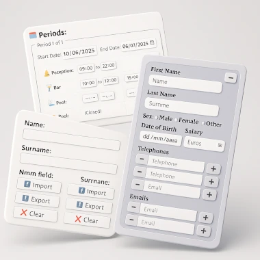

[](https://smarkform.bitifet.net)

# SmarkForm

**Complex HTML forms without complex JavaScript.**

SmarkForm is a **markup-driven controller for structured HTML forms**. Annotate
your markup with `data-smark`, and the DOM becomes a tree of **fields** that
imports and exports as JSON.

In SmarkForm, **everything is a field**, and every field returns a JSON value.
A **form** is a field composed of named fields (it returns an object); a
**list** is a field composed of a sequence of fields (it returns an array); an
**input** returns a string, a **number** returns a number, a **checkbox** a
boolean, and so on. Because forms and lists are themselves fields, you can nest
them to any depth and describe any JSON data structure — including
variable-length arrays, clamped to a length range or not.

No component framework. No imposed DOM structure or CSS.

[![NPM Version][npm-image]][npm-url]
[![npm dependencies][dependencies-image]][dependencies-url]
[![NPM Downloads][downloads-image]][downloads-url]
[![jsDelivr Hits][cdnhits-image]][cdnhits-url]
[![License][license-image]][license-url]
<!-- Highlighting fix: []() -->

📋 **Quick reference:** See the [Developer Cheatsheet](https://smarkform.bitifet.net/resources/cheatsheet) for the full API surface, actions, events, and component types at a glance.

<p align="center">
  
</p>

<!-- 🎞️ Placeholder: replace/extend the hero with a short screencast that
     annotates plain HTML with data-smark, initializes SmarkForm, then grows a
     nested list and watches the exported JSON update. -->

## The idea in one example

Real forms are rarely flat: an order contains line items, a person contains
phones and addresses, a school contains students. In plain HTML that structure
is easy to *draw* but hard to *manage*, because every row you add needs
JavaScript to wire it up and keep it in sync with your data.

SmarkForm describes the structure once, in markup. Here is a **list of nested
objects**:

```html
<div id="form">
  <input name="name" data-smark placeholder="Name">
  <input name="email" data-smark placeholder="Email">

  <ul data-smark='{"type":"list","name":"phones"}'>
    <li><input name="number" type="tel" data-smark placeholder="Phone"></li>
  </ul>

  <button data-smark='{"action":"addItem","context":"phones"}'>➕ Add phone</button>
  <button data-smark='{"action":"removeItem","context":"phones"}'>➖ Remove phone</button>
  <button data-smark='{"action":"export"}'>💾 Save</button>
</div>
```

One line of JavaScript to bring it to life:

```javascript
const form = new SmarkForm(document.querySelector("#form"));
```

Read the data whenever you need it:

```javascript
const data = await form.export();
console.log(data);
```

...or react to the declared `"export"` trigger:

```javascript
form.on("AfterAction_export", ({ data }) => console.log(data));
```

...and this is what comes out of it:

```json
{
  "name": "Alice",
  "email": "alice@example.com",
  "phones": [{ "number": "555-1234" }]
}
```

> **The HTML is your UI. The JSON is your data. SmarkForm connects them.**

Every `data-smark` element becomes a **field** — forms return objects, lists
return arrays — and the data stays in sync as the user adds, removes, sorts or
moves things, with no manual wiring.


## Everything is a field

The one idea behind SmarkForm is that **every component is a field**, and every
field produces a JSON value:

```
                       field
                         │
           ┌─────────────┴─────────────┐
           │                           │
    composite fields                  value fields
    (made of fields)                  (a single value)
           │                           │
    ┌──────┴──────┐                   string · number · boolean
    │             │                   ISO date / time strings
  form          list                  "#RRGGBB"  or null
    │             │                   data URL / object  or null
    ▼             ▼
 { object }   [ array ]
    │             │
    └──────┬──────┘
           ▼
    nested JSON data,
      to any depth
```

The differences between component types are only the *shape* of the value they
return:

| Field type | Returns (JSON) | Notes |
|------------|----------------|-------|
| `form` | object `{ … }` | composed of *named* child fields |
| `list` | array `[ … ]` | a sequence of fields; grows and shrinks at runtime |
| `input` | string | with `format:"json"`, the text parses to any JSON value |
| `number` | number or `null` | string values are coerced |
| `checkbox` | boolean | |
| `radio` | string or `null` | radios sharing a name behave as one field |
| `date`, `time`, `datetime-local` | ISO string or `null` | normalised on import and export |
| `color` | `"#RRGGBB"` or `null` | `null` means *not selected* — impossible with native color inputs |
| `file` | data-URL string, or object with `format:"json"`, or `null` | |
| `image`, `video`, `audio` | same as `file` | specialised `file` fields |

Because a **form** and a **list** are themselves fields, they can contain other
forms and lists. Nest them to any depth and you describe **any JSON data
structure** — including variable-length arrays, optionally clamped to a length
range with `min_items` / `max_items`.

The rest of the model follows from that:

  * A **trigger** is a component that performs an **action** on a field (add an
    item, export data, navigate…) — it holds no data itself.
  * A **label** is a component that only displays text; it holds no data
    either, but it automatically connects to the corresponding field — no manual
    `for="…"` needed.
  * Components are addressed by their place in the SmarkForm **tree**, not the
    DOM.
  * Value fields whose JSON type has no empty form — number, date, color, radio,
    file… — return `null` to mean *unknown* or *not applicable*, instead of a
    misleading value.

<!-- 🎞️ Placeholder: replace this ASCII diagram with an animated SVG/GIF that
     highlights each node as it is mentioned above. -->

That single model is the whole conceptual key. Everything else in the
documentation is a variation of it.


## Nested data and dynamic lists

Because a form and a list are just fields, the real payoff is structure: forms
nested inside forms, lists nested inside lists, and objects nested inside
lists — all described once, in plain HTML.

Here is a three-level structure (groups → students → grades) with no
application-specific JavaScript:

```html
<div id="school">
  <input name="name" data-smark placeholder="School name">

  <ul data-smark='{"type":"list","name":"groups"}'>
    <li>
      <input name="tutor" data-smark placeholder="Tutor">

      <ul data-smark='{"type":"list","name":"students"}'>
        <li>
          <input name="name" data-smark placeholder="Student">

          <div data-smark='{"type":"form","name":"grades"}'>
            <input name="math" type="number" data-smark>
            <input name="science" type="number" data-smark>
          </div>
        </li>
      </ul>

      <button data-smark='{"action":"addItem","context":"students"}'>➕ Add student</button>
    </li>
  </ul>

  <button data-smark='{"action":"addItem","context":"groups"}'>➕ Add group</button>
</div>
```

...and the JSON it exports:

```json
{
  "name": "Springfield Elementary",
  "groups": [
    {
      "tutor": "Ms. Krabappel",
      "students": [
        { "name": "Bart", "grades": { "math": 4, "science": 3 } }
      ]
    }
  ]
}
```

The `➕ Add` buttons carry no code — they are declared with `data-smark` and
act on the list they can reach. Lists can be reordered and items can be moved
between nested lists, and the data follows.

▶ **[Try it live](https://smarkform.bitifet.net/about/showcase#multiple-level-nesting)**
in the interactive playground, with HTML, CSS, JS and the resulting JSON side
by side.

<!-- 🎞️ Placeholder: a short screencast of adding groups, students and grades
     and watching the JSON pane update live. -->


## Real-world examples

The [Showcase](https://smarkform.bitifet.net/about/showcase) is a large set of
runnable, editable examples. Some highlights:

  * [Multiple-level nesting](https://smarkform.bitifet.net/about/showcase#multiple-level-nesting)
  * [Deeply nested forms](https://smarkform.bitifet.net/about/showcase#deeply-nested-forms)
  * [Nested lists and forms](https://smarkform.bitifet.net/about/showcase#nested-lists-and-forms)
  * [Smooth navigation](https://smarkform.bitifet.net/about/showcase#smooth-navigation)
  * [Context-driven hotkeys](https://smarkform.bitifet.net/about/showcase#context-driven-keyboard-shortcuts-hot-keys)
  * [Field masking](https://smarkform.bitifet.net/about/showcase#field-masking)
  * [Team Event Planner](https://smarkform.bitifet.net/about/showcase#team-event-planner)
  * [Simple Calculator](https://smarkform.bitifet.net/about/showcase#simple-calculator)

Prefer to start from working code? Download any of the
[ready-to-run examples](https://smarkform.bitifet.net/resources/examples) —
Company, TO-DO List, Adventure Tracking, Beach Surveillance, Event
Registration, Expense Report, Medical Intake, Property Inspection, Restaurant
Reservation — and edit it locally.


## `data-smark`: the only attribute you need

Configuration lives in a single attribute, and it can be reduced to almost
nothing:

```html
<!-- Nothing at all: type and name are inferred from the tag and its attributes -->
<input name="email" data-smark>

<!-- Minimal: a field needs a name; the type is inferred (ul → list) -->
<ul data-smark='{"name":"students"}'> … </ul>

<!-- The same, as a data-smark-<option> attribute -->
<ul data-smark-name="students"> … </ul>

<!-- String shorthand: the value is just the component type. Useful when the
     tag doesn't imply it (a div can be a list); a name is still required. -->
<div data-smark="list" data-smark-name="students"> … </div>

<!-- The type is often inferred from the tag, so data-smark can be bare -->
<label data-smark>Your e-mail</label>
<textarea data-smark></textarea>

<!-- The HTML input type stays native: this is a SmarkForm "input" field of type email -->
<input name="email" type="email" data-smark>

<!-- Inside a list, the item template needs no data-smark at all. With
     of:"input", each <li> wraps one unnamed field (the Singleton Pattern) and
     can still carry its own label and buttons. -->
<ul data-smark='{"name":"emails","of":"input"}'>
  <li>
    <label data-smark>Your e-mail</label>
    <input type="email" data-smark>
    <button data-smark-action="removeItem">➖</button>
  </li>
</ul>

<!-- Full form: any component options, as JSON -->
<input data-smark='{"type":"input","name":"email","placeholder":"you@example.com"}'>

<!-- Per-option attributes: convenient with template engines -->
<input data-smark-type="input" data-smark-name="email" data-smark-placeholder="you@example.com">
```

**Why JSON inside `data-smark`?** SmarkForm deliberately keeps a component's
configuration in **one** attribute so that the markup stays portable: no
framework-specific attribute conventions, and a single, predictable place to
look. The string shorthand (`data-smark="list"`) and the `data-smark-<option>`
attributes are conveniences layered on top of that single JSON object, not a
different model.

👉 Full syntax: [The `data-smark` attribute](https://smarkform.bitifet.net/getting_started/core_concepts#the-data-smark-attribute)
and [Shorthand syntaxes](https://smarkform.bitifet.net/getting_started/core_concepts#shorthand-syntaxes).


## Contexts, targets and actions

A **trigger** is any element carrying an `action`. By default it acts on the
component it can reach from its own position in the tree:

```html
<ul data-smark='{"type":"list","name":"contacts"}'>
  <li>
    <input name="name" data-smark>
    <button data-smark='{"action":"removeItem"}'>➖</button>
  </li>
</ul>
<button data-smark='{"action":"addItem"}'>➕ Add contact</button>
```

When you need to reach somewhere else, address the component **by name or
path** instead of by DOM position. This is what keeps your code stable when the
layout changes:

```
Form
│
├── customer
│
└── contacts
    ├── contact #1 → name, phones[]
    │
    └── contact #2 → name, phones[]
```

```html
<button data-smark='{"action":"addItem","context":"/contacts"}'>➕ Add contact</button>
<button data-smark='{"action":"export","context":"/invoice"}'>💾 Export invoice</button>
```

Paths traverse the SmarkForm tree, not the DOM, and support parents (`..`),
siblings (`.-1`) and wildcards (`*`).

👉 Full reference: [Form Traversing](https://smarkform.bitifet.net/working_with_forms/form_traversing).


## Why SmarkForm?

| Approach | UI defined by | Data model | Dynamic nested lists |
|----------|---------------|------------|----------------------|
| Native HTML | HTML | manual | manual JS |
| React / Vue form libraries | components | framework state | framework-specific |
| Schema-driven form generators | schema | schema | renderer-dependent |
| **SmarkForm** | **HTML** | **JSON** | **built in** |

The point is not that SmarkForm "wins". It's that SmarkForm chooses **HTML as
the source of truth** — your markup *is* the form definition, and the JSON data
model is derived from it rather than replacing it.


## What you get

**Core concepts** — how SmarkForm works:

  * [Markup-driven](https://smarkform.bitifet.net/about/features#markup-agnostic):
    every `data-smark` element is a field that returns a JSON value.
  * [Nested forms](https://smarkform.bitifet.net/about/features#nestable-forms)
    and [variable-length lists](https://smarkform.bitifet.net/about/features#variable-length-lists)
    are themselves fields, so they nest to any depth — of scalars or subforms.
  * Declarative [triggers, actions and contexts](https://smarkform.bitifet.net/working_with_forms/form_traversing),
    addressed by relative paths — not by DOM position.
  * [JSON import and export](https://smarkform.bitifet.net/about/features#json-based)
    for the whole form or any sub-tree.

**Benefits** — why you'd want it:

  * Little or no manual wiring between controls and data.
  * Complete freedom over layout and CSS — SmarkForm imposes neither.
  * [Framework independence](https://smarkform.bitifet.net/about/features#markup-agnostic):
    works with whatever renders your HTML.
  * [Keyboard navigation](https://smarkform.bitifet.net/about/features#consistent-user-experience)
    and [accessibility](https://smarkform.bitifet.net/about/features#a11y-friendly)
    built in.

**Secondary properties** — nice to have:

  * [Lightweight and dependency-free](https://smarkform.bitifet.net/about/features#lightweight-yet-highly-compatible).
  * [Context-driven hotkeys](https://smarkform.bitifet.net/about/features#context-driven-hotkeys).
  * [Extendable](https://smarkform.bitifet.net/about/features#flexible-and-extendable)
    with custom component types and HTML
    [mixin templates](https://smarkform.bitifet.net/advanced_concepts/mixin_types).


## Install

```sh
npm install smarkform
```

Or load it straight from a CDN — as a global UMD script:

```html
<script src="https://cdn.jsdelivr.net/npm/smarkform/dist/SmarkForm.umd.js"></script>
<script>
  const form = new SmarkForm(document.querySelector("#form"));
</script>
```

...or as an ES module:

```html
<script type="module">
  import SmarkForm from "https://cdn.jsdelivr.net/npm/smarkform/dist/SmarkForm.esm.js";
</script>
```

> 📌 The snippets above track the latest published version (handy for
> playgrounds). For production, pin a specific version; see
> [Getting SmarkForm](https://smarkform.bitifet.net/getting_started/getting_smarkform).


## Framework agnostic — on purpose

SmarkForm is not a React, Vue or Svelte library, and that is a deliberate
choice. It manages the form markup you already have, so it composes with
whatever rendered it — server-side templates, vanilla JavaScript, Web
Components, or a component framework. Point `new SmarkForm(...)` at a
container and SmarkForm owns that form's **structure and interaction**, not
your rendering.


## Scope: structure and interaction, not validation

SmarkForm manages the structure and interaction of your form. It does **not**
replace native HTML validation or your server-side validation. Use the
platform:

```html
<input name="email" type="email" required data-smark>
```


## Accessibility

SmarkForm keeps forms keyboard-navigable, manages focus around dynamically
added and removed items, and fills in missing ARIA attributes where it can.
Semantic labelling remains the responsibility of your markup. Feedback and
bug reports are welcome in the
[A11Y discussion](https://github.com/bitifet/SmarkForm/discussions/25).

👉 See [Smooth navigation](https://smarkform.bitifet.net/about/showcase#smooth-navigation)
and [Context-driven hotkeys](https://smarkform.bitifet.net/about/showcase#context-driven-keyboard-shortcuts-hot-keys)
for keyboard-first examples.


## Size

**~110 KB minified · ~30 KB gzip · ~26 KB brotli · zero runtime
dependencies**, shipped as both a tree-shakeable ES module and a universal UMD
bundle.

The dependency count is the important number: SmarkForm pulls in nothing else,
so it never becomes the reason you need another framework in your page.


## Status and roadmap

SmarkForm is at **0.x**: the implemented features are stable and in active use,
but the public API may still change before 1.0.

Not implemented yet — on the roadmap, not committed to a release:

  * Built-in validation and interoperability with JSON Schema.
  * TypeScript declarations for the public API.
  * A machine-readable, generated API reference.
  * Shareable, URL-addressable playground examples.

SmarkForm is also deliberately **framework-agnostic**: there is no React / Vue /
Svelte wrapper, and none is planned as a first-class dependency. A small set of
integration recipes may come later.


## Usage and Documentation

For detailed usage instructions and API reference check out the
[📔 SmarkForm Reference Manual](https://smarkform.bitifet.net).

<a href="https://smarkform.bitifet.net">

</a>

  * [Showcase](https://smarkform.bitifet.net/about/showcase) — interactive
    examples of everything SmarkForm can do.

  * [Quick Start](https://smarkform.bitifet.net/getting_started/quick_start) —
    from an empty page to a working form.

  * [Live Examples](https://smarkform.bitifet.net/resources/examples) —
    downloadable forms you can run locally and tinker with.

  * [Getting SmarkForm](https://smarkform.bitifet.net/getting_started/getting_smarkform) —
    ESM and UMD, via npm, GitHub or CDN.

  * [Developer Cheatsheet](https://smarkform.bitifet.net/resources/cheatsheet) —
    the whole API at a glance.


## Troubleshooting and FAQ

For troubleshooting tips and frequently asked questions, see the
[Frequently Asked Questions (FAQ)](https://smarkform.bitifet.net/about/faq).


## Community and Support

Open a [discussion on the GitHub repository](https://github.com/bitifet/SmarkForm/discussions)
if you don't find an answer in the docs.

You can also reach out through the [Contact Page](https://smarkform.bitifet.net/community/contact)
or by email at [smarkform@bitifet.net](mailto:smarkform@bitifet.net).

### 🚀 Stay tuned

<div style="display: flex; flex-wrap: wrap; justify-content: center; gap: 1rem; padding: 1rem;">
  <div style="flex: 1; max-width: 20vw; min-width: 250px; text-align: center;">
    <b>News and announcements:</b>
    <a href="https://t.me/smarkform" rel="noopener noreferrer">
    
    </a>
  </div>
  <div style="flex: 1; max-width: 20vw; min-width: 250px; text-align: center;">
    <b>Community Chat:</b>
    <a href="https://t.me/SmarkFormCommunity" rel="noopener noreferrer">
    
    </a>
  </div>
</div>


## Contributing

Contributions are welcome! If you find any issues or have suggestions for improvements, please open an issue or submit a pull request.

Before contributing, make sure to read our [contribution guidelines](CONTRIBUTING.md).

Please note that this project is released with a [Contributor Code of Conduct](CODE_OF_CONDUCT.md). By participating in this project you agree to abide by its terms.


## License

  [MIT](LICENSE)


## Keywords

front-end – form – form-controller – form-library – json-form – lightweight –
vanilla – css-agnostic – DOM – html-form – no-dependencies – a11y


[npm-image]: https://img.shields.io/npm/v/smarkform.svg
[npm-url]: https://npmjs.org/package/smarkform
[dependencies-image]: https://img.shields.io/badge/dependencies-0-green
[dependencies-url]: https://www.npmjs.com/package/smarkform?activeTab=dependencies
[downloads-image]: https://img.shields.io/npm/dm/smarkform.svg
[downloads-url]: https://npmjs.org/package/smarkform
[cdnhits-image]: https://data.jsdelivr.com/v1/package/npm/smarkform/badge?style=rounded
[cdnhits-url]: https://www.jsdelivr.com/package/npm/smarkform
[license-image]: https://img.shields.io/badge/license-MIT-brightgreen.svg
[license-url]: https://opensource.org/licenses/MIT
